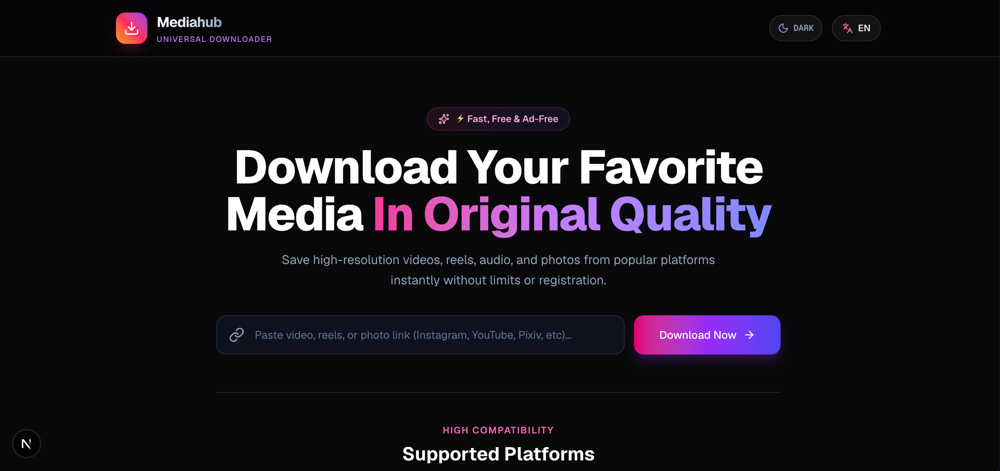

# MediaDL

**MediaDL** is a modern, fast, and extensible multi-platform media downloader built with Next.js App Router, TypeScript, and Tailwind CSS. It allows users to seamlessly extract and download high-quality videos, reels, photos, stories, and illustrations from popular social media platforms.



---

## ✨ Key Features

- **3-Tier Smart Resolution Engine**:
  - **Priority 1: Dedicated Extensions**: Handcrafted high-performance scrapers for complex platforms (**Instagram**, **Pixiv**, adult manga/galleries).
  - **Priority 2: `gallery-dl` Integration**: Native support for **350+ image hosts, boorus, manga, and art communities** (DeviantArt, Danbooru, Flickr, etc.) with automatic domain matching via `galleryDlSupportedSites.json`.
  - **Priority 3: `yt-dlp` Universal Fallback**: Robust fallback for all universal video/audio streaming platforms (YouTube, Twitter/X, TikTok, etc.).
- **Smart Anti-CORS Binary Streaming**: Direct streaming engine (`/api/stream`) delivering binary video and audio files with native browser download triggers and zero CORS blocking.
- **Bulk ZIP Downloads**: Automatically package multiple media items (carousels, multi-page manga, albums) into a single `.ZIP` archive with full binary files.
- **Audio Only Extraction**: Extract pure audio tracks (`.m4a`) from music videos and reels.
- **Dark, Light & System Theme**: Theme engine with system default auto-detection, instant switcher, and zero FOUC.
- **Multi-Language Support**: Instant UI language switcher supporting **English (EN)** and **Bahasa Indonesia (ID)**.
- **Admin Dashboard & Cookie Management**: Database-driven session storage (SQLite via Drizzle ORM) with automated cookie rotation across extensions, `yt-dlp`, and `gallery-dl`.
- **Ad-Free & Zero-Log**: Direct CDN fetching with no intrusive ads, pop-ups, or server-side media retention.

---

## 🛠️ Tech Stack

- **Framework**: [Next.js](https://nextjs.org/) (App Router)
- **Language**: TypeScript
- **Styling**: Tailwind CSS & CVA (Class Variance Authority)
- **Database & ORM**: SQLite (`better-sqlite3`) with Drizzle ORM
- **Icons & Utilities**: Lucide React, JSZip, File-Saver

---

## 🚀 Getting Started & Deployment

### Option 1: Running with Docker (Recommended)

You can run MediaDL instantly using Docker and the official prebuilt image from GitHub Container Registry:

```bash
docker run -d \
  --name mediadl \
  -p 3000:3000 \
  -e APP_URL=http://localhost:3000 \
  -e AUTH_SECRET=your_super_secret_auth_key \
  -e AUTH_URL=http://localhost:3000 \
  ghcr.io/fiand1996/mediadl:latest
```

Or use Docker Compose (see [Running & Environment Guide](./docs/running-and-env.md)).

### Option 2: Local Development

Make sure you have [Node.js](https://nodejs.org/) (v20.9+), [pnpm](https://pnpm.io/) 12.18.0, and optionally `yt-dlp` and `gallery-dl` installed.

1. Clone the repository and install dependencies:

   ```bash
   pnpm install
   ```

2. Configure your `.env` file (see `.env.example` and [Running & Environment Guide](./docs/running-and-env.md)).

3. Initialize the database and run the development server:

   ```bash
   pnpm db:push
   pnpm dev
   ```

4. Open [http://localhost:3000](http://localhost:3000) in your browser.

---

## 📚 Documentation

For comprehensive guides and architecture details, check out the `docs/` directory:

- [Running and Environment Configuration Guide](./docs/running-and-env.md) - Detailed setup, environment variables reference, and Docker deployment.
- [Architecture & System Design](./docs/architecture.md) - Decoupled extension registry, `gallery-dl` engine, `yt-dlp` fallback, and streaming proxy.
- [Cookie Management & Rotation Guide](./docs/cookie.md) - Platform burner cookies and Netscape cookie rotation.

---

## ⚠️ Disclaimer

This tool is intended for personal use only. Please respect copyright laws and the terms of service of the platforms you download from. The developers are not responsible for any misuse of this tool.

---

## 📄 License

[MIT](./LICENSE)
