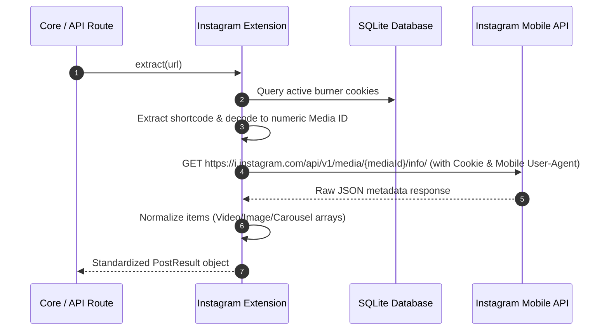

# Instagram Extension: Technical & Fetching Mechanism

This document outlines how the Instagram extension extracts media (Reels, Videos, Stories, and Carousels) using a native server-to-server mobile API engine injected with authenticated sessions.

---

## 1. Core Extraction Strategy

Unlike third-party downloaders that rely on external scrapers or CLI tools, this extension communicates directly with Instagram's internal mobile API endpoints using authenticated Netscape cookies.

### Key Components:
- **Manifest (`manifest.ts`)**: Defines platform metadata, ID, name, and URL regex patterns for matching supported Instagram links.
- **Handler (`index.ts`)**: Implements shortcode decoding, mobile API calls, response normalization, and error handling.
- **Cookie Rotation (`lib/cookieRotator.ts`)**: Manages active burner account cookies stored in the database to avoid rate limits or anonymous limitations.

---

## 2. Extraction Workflow



---

## 3. Implementation Details

### A. Shortcode Decoder
Instagram post URLs use string-based shortcodes (e.g., `https://www.instagram.com/p/DfE10UGkgvA/`). These are decoded into numeric media IDs using a Base64 variant lookup algorithm:

```ts
function decodeShortcode(shortcode: string) {
  const alphabet = "ABCDEFGHIJKLMNOPQRSTUVWXYZabcdefghijklmnopqrstuvwxyz0123456789-_";
  let id = BigInt(0);
  for (let i = 0; i < shortcode.length; i++) {
    id = (id * BigInt(64)) + BigInt(alphabet.indexOf(shortcode[i]));
  }
  return id.toString();
}
```

### B. Mobile API Endpoint & Headers
- **Endpoint**: `https://i.instagram.com/api/v1/media/{mediaId}/info/`
- **User-Agent**: Mimics the official Instagram mobile app (`Instagram 290.0.0.21.111 ...`).
- **Headers**: Includes `X-IG-App-ID` and rotation cookies (`sessionid`, `csrftoken`, etc.).
