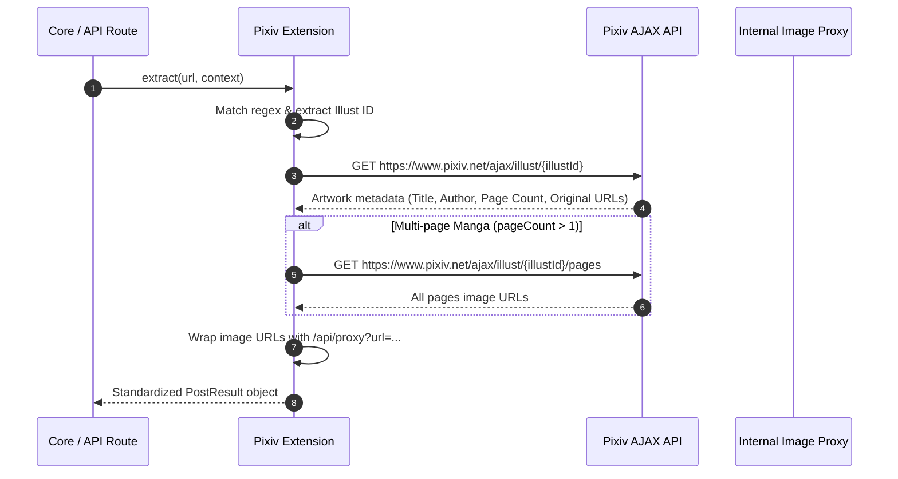

# Pixiv Extension: Artwork & Manga Ingestion

This document details the architecture and fetching mechanics of the **Pixiv** extension in **Mediahub**.

---

## 1. Core Extraction Strategy

The Pixiv extension communicates with Pixiv's public and AJAX JSON endpoints to extract illustrations, multi-page manga, and high-resolution original artwork URLs.

### Key Components:
- **Manifest (`manifest.ts`)**: Defines Pixiv platform metadata, unique ID, name, and URL regex patterns (`pixiv.net/artworks/{id}`).
- **Handler (`index.ts`)**: Parses artwork IDs from URLs, queries Pixiv AJAX endpoints (`/ajax/illust/{id}` and `/pages`), and handles multi-page gallery iteration.
- **Referer & Image Proxy (`/api/proxy`)**: Pixiv heavily restricts direct hotlinking of images by checking the `Referer: https://www.pixiv.net/` header. The extension automatically routes thumbnail and media preview URLs through the internal proxy route.

---

## 2. Extraction Workflow



---

## 3. Implementation Details

### A. Artwork ID Parsing
Extracts numerical IDs from Pixiv artwork URLs:
```ts
const match = url.match(/artworks\/([0-9]+)/i);
const illustId = match ? match[1] : null;
```

### B. Hotlink Protection & Referer Spoofing
Pixiv requires specific request headers to bypass 403 Forbidden responses:
- **Referer**: `https://www.pixiv.net/`
- **User-Agent**: Standard desktop browser user-agent string.
- **Proxy Routing**: Resulting image URLs are proxied (`/api/proxy?url=...`) to ensure images load successfully in frontend preview cards without CORS or hotlink blocking.
